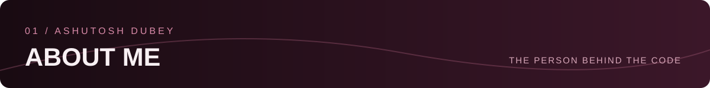
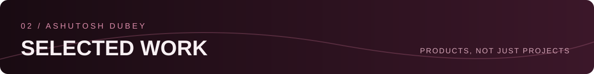
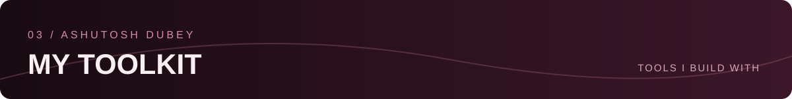

<!-- Ashutosh Dubey | GitHub Profile README | Inspired by the supplied editorial portfolio README layout -->

  

  
  
  

  <b>Java Full Stack Developer</b> &nbsp;·&nbsp; Building useful products &nbsp;·&nbsp; Learning every day

I'm <b>Ashutosh Dubey</b>, a Java Full Stack Developer who enjoys building responsive web applications, practical REST APIs and database-backed systems. I work across frontend and backend, with a focus on clean code, useful user experiences and continuous improvement.

- 🎓 MCA student at **Galgotias University** (2024–2026)
- 💻 Interested in **Java, Spring Boot, React.js, REST APIs and database design**
- 🧩 Enjoy building end-to-end projects and solving real-world problems
- 🌱 Currently strengthening **DSA, Java and full-stack engineering**
- 🤝 Open to developer opportunities, internships and meaningful collaborations

  

### 01 · SprintDesk — Productivity & Project Workspace
A modern dashboard and project workspace focused on organized workflows, task tracking and clear team visibility.

**Stack:** React · TypeScript · Tailwind CSS · Zustand

  
  

### 02 · Nexora — Social & Communication Platform
A full-stack platform exploring user profiles, messaging, notifications and real-time communication experiences.

**Stack:** React · Java · Spring Boot · MySQL · WebSocket

### 03 · BrainBrew Cafe — Business Website
A responsive cafe website with a distinct visual identity and customer-friendly browsing experience.

**Stack:** HTML · CSS · JavaScript

  
  

### 04 · College ERP Management System
An academic management solution concept focused on structured workflows and role-oriented operations.

**Stack:** Java · Spring Boot · React · MySQL

  

### 05 · TaskGenZ — Task Management
A task management dashboard designed to make daily planning and progress tracking approachable.

**Stack:** Web technologies · Dashboard UI

  

  

| Area | Technologies |
|---|---|
| **Languages** | Java, JavaScript, TypeScript, SQL |
| **Frontend** | React.js, HTML5, CSS3, Tailwind CSS, Bootstrap |
| **Backend** | Spring Boot, REST APIs, JDBC |
| **Databases** | MySQL, MongoDB, PostgreSQL |
| **Tools** | Git, GitHub, Postman, Maven, VS Code, NetBeans |

| Period | Journey |
|---|---|
| **2025** | Java Full Stack Developer Trainee — **Wipro TalentNext** |
| **2025** | Java Full Stack Virtual Internship — **EduSkills**; built a Student Management System using HTML, CSS, JavaScript, Spring Boot and MySQL |
| **2024–2026** | Master of Computer Applications — **Galgotias University** |
| **2021–2024** | Bachelor of Computer Applications — **Global Group of Institutes** |

  

### GitHub at a glance

  
  

  

  
  

  

  <i>Build things. Learn continuously. Solve real problems.</i>

