

  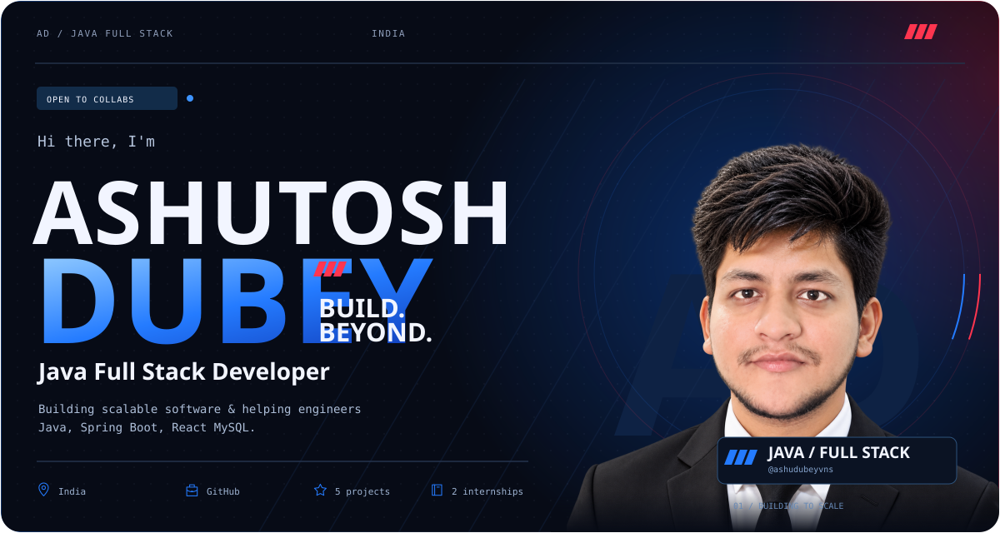

  
  

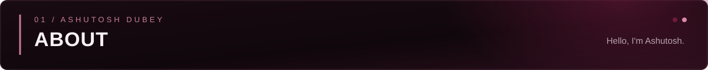
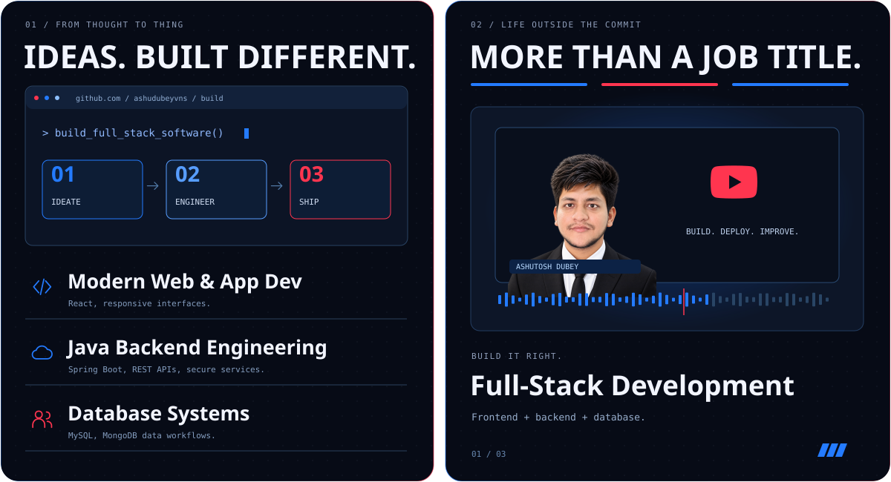

  <b>Java Full Stack Developer</b> · MCA Student · India

I'm **Ashutosh Dubey**, a developer focused on building useful web applications and reliable backend systems. I enjoy working across the stack—from responsive React interfaces to Java/Spring Boot APIs and database design.

- Building with **Java, Spring Boot, React and MySQL**
- Interested in **backend engineering, REST APIs, system design and DSA**
- Learning by shipping projects and improving them through real feedback
- Open to developer opportunities and collaborations

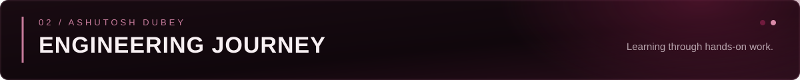
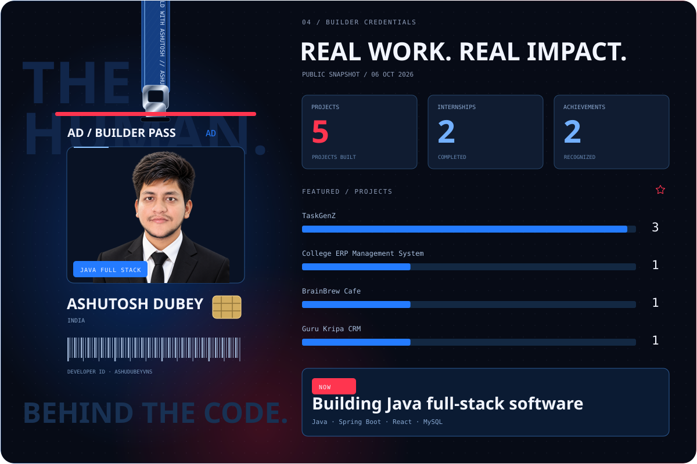

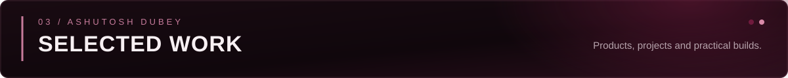

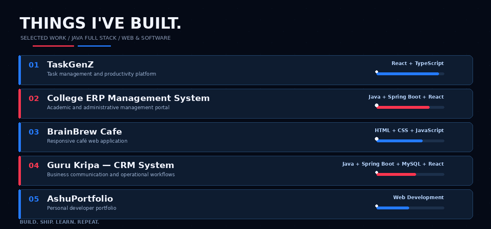

### Featured projects

**SprintDesk** — Productivity and project workspace built with React, TypeScript and Tailwind CSS.  
<a href="https://sprint-desk-mauve.vercel.app/">Live demo</a> · <a href="https://github.com/ashudubeyvns/SprintDesk">Source code</a>

**College ERP Management System** — Academic management application with role-oriented workflows.  
<a href="https://college-erp-management-system-ashu.vercel.app">Live demo</a>

**TaskGenZ** — Task management dashboard for organizing daily work.  
<a href="https://task-gen-z.vercel.app/dashboard">Live demo</a>

**BrainBrew Cafe** — Responsive cafe website with a customer-friendly browsing experience.  
<a href="https://brainbrewcafe.netlify.app">Live demo</a> · <a href="https://github.com/ashudubeyvns/BrainBrew">Source code</a>

**Guru Kripa / Nexora** — Full-stack CRM and communication platform exploring profiles, messaging and operational workflows.

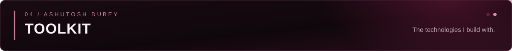

| Area | Technologies |
|---|---|
| Languages | Java, JavaScript, TypeScript, SQL |
| Frontend | React.js, HTML5, CSS3, Tailwind CSS, Bootstrap |
| Backend | Spring Boot, REST APIs, JDBC |
| Databases | MySQL, MongoDB, PostgreSQL |
| Tools | Git, GitHub, Postman, Maven, VS Code, NetBeans |

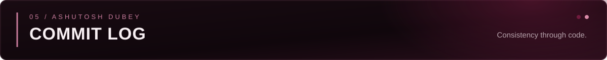

  

  

| Period | Experience / Education |
|---|---|
| 2025 | **Wipro TalentNext** — Java Full Stack Developer Trainee |
| 2025 | **EduSkills** — Java Full Stack Virtual Internship; Student Management System |
| 2024–2026 | **Galgotias University** — Master of Computer Applications |
| 2021–2024 | **Global Group of Institutes** — Bachelor of Computer Applications |
| — | **Internshala** — Web Developer Internship |

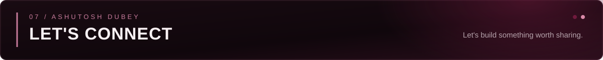

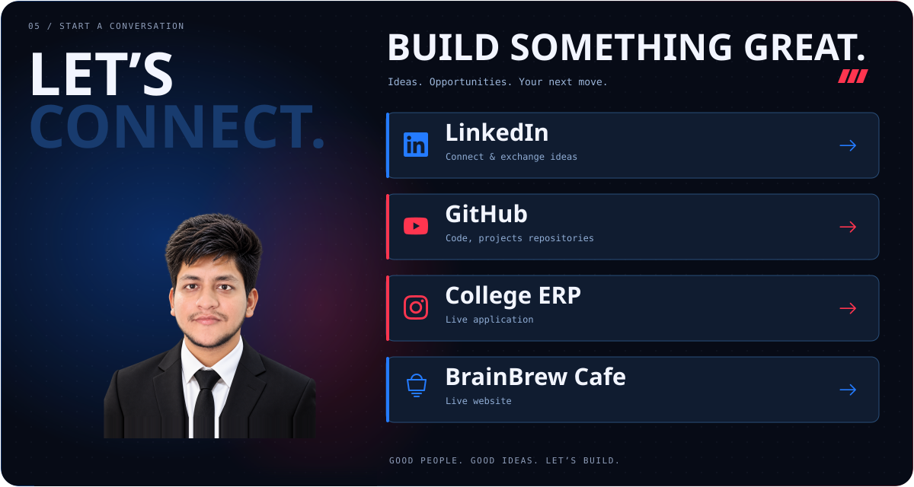

  
  

<i>Build things. Learn continuously. Solve real problems.</i>

